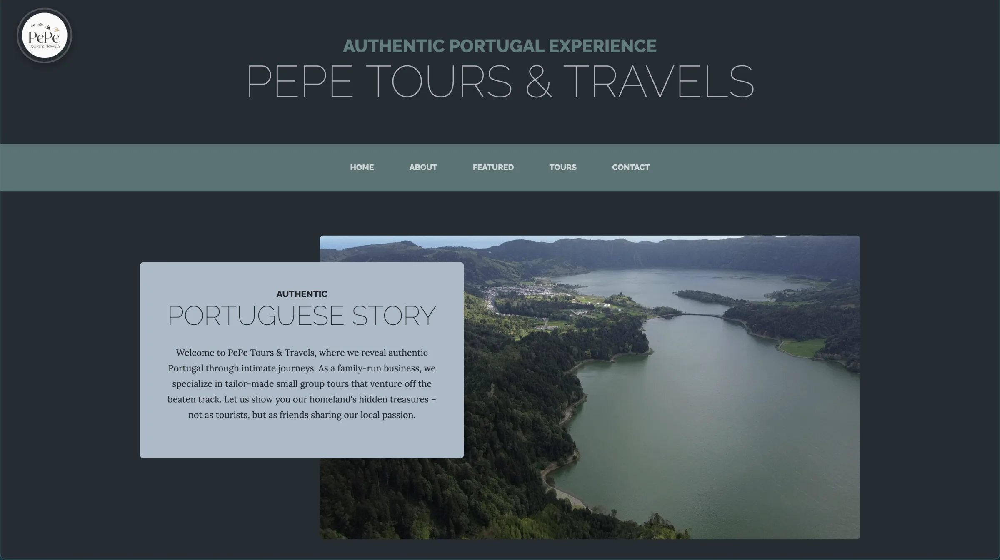

# PePe Tours & Travels

**[diogof146.github.io/pepe-tours-travels](https://diogof146.github.io/pepe-tours-travels/)**

The website for PePe Tours & Travels, a family-run company that does private tours from Porto: the city, the Douro Valley, Braga and Guimarães, Coimbra and Aveiro, Fátima and more. I built it as a freelance project in the summer of 2025, and it was my first website.

The site has a home page with videos, the tours, a featured page, an about page, and a contact page that goes to WhatsApp or email.

## How it's built

It's plain HTML, CSS and JavaScript on top of Bootstrap, hosted on GitHub Pages.

The twelve tours share one page, `tour-details.html`. The script reads which tour to show from the URL and fills in its photos, highlights, what's included and the prices. Prices depend on the season and the size of the group, from two people up to seven; bigger groups are asked to get in touch, with an email that already has the tour and the group size written in.

The videos only load when they're about to come on screen, and tapping one opens it in full screen.

## License

This project was developed for and is the property of PePe Tours & Travels.
All rights reserved.
Do not reuse or redistribute without permission.
